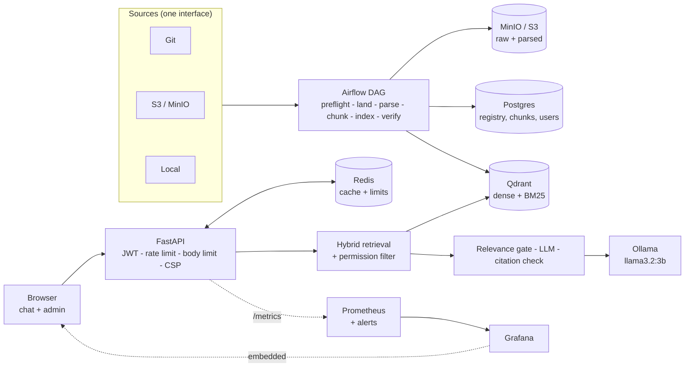

# EKRP: Enterprise Knowledge Retrieval Platform

**A retrieval-augmented support assistant that answers from a company knowledge base with validated citations, permission-aware retrieval and measured quality. It runs on a laptop CPU.**

It syncs documents from a pluggable source, keeps a hybrid search index fresh, answers questions through a small local model, and refuses anything the knowledge base cannot support. Login, rate limiting, caching, monitoring and an admin dashboard are built in. Every external dependency (document source, object store, vector store, LLM) sits behind an interface, so moving to AWS S3, SharePoint or your own data means a new connector and a re-measurement, not a rewrite ([how](docs/ADAPTING.md)).

> **Sample data.** The demo corpus is the open GitLab handbook (about 400 pages). Its permission labels are **synthetic** (derived from file paths), because open data has no access-control lists. The enforcement is real; the labels are stand-ins. See [Limits](#limits).

## Contents

[Features](#features) · [Architecture](#architecture) · [Results](#results) · [Quick start](#quick-start-windows) · [Using it](#using-it) · [Configuration](#configuration) · [Security and guardrails](#security-and-guardrails) · [Testing](#testing) · [Layout](#project-layout) · [Documentation](#documentation) · [Limits](#limits) · [Licence](#data-and-licences)

## Features

| Area | What it does |
|---|---|
| **Ingestion** | Connectors for git, S3/MinIO and local folders. Content-hash landing makes re-runs idempotent. Parses md, html, docx, pdf, txt; heading-aware chunking with overlap. |
| **Incremental sync** | Detects new, changed and deleted files. A failed or partial listing never deletes; mass deletions (over 30%) need `--force-deletes`. A Postgres advisory lock prevents overlapping runs. |
| **Orchestration** | An Airflow DAG (`ekrp_sync`) with per-source tasks, retries, timeouts and a final consistency check. The same stages also run without Airflow (`python -m orchestration.etl all`) or on an APScheduler cron. |
| **Retrieval** | Dense (bge-small) plus BM25 in Qdrant, fused with reciprocal-rank fusion. The role's permission filter is applied inside every vector query, so restricted text is never retrieved. |
| **Answers** | Local `llama3.2:3b` via Ollama, streamed. A calibrated relevance gate refuses off-topic questions in about 30 ms without calling the model. Every `[n]` citation is checked against the retrieved sources. |
| **API and UI** | FastAPI with JWT login, a streaming chat page, Redis answer cache and Redis rate limiting (both fall back to in-process if Redis is down). |
| **Admin page** | `/admin` (admin role only): live metrics next to an embedded Grafana dashboard. |
| **Monitoring** | Prometheus metrics, 11 alert rules, a generated 18-panel Grafana dashboard. |
| **Evaluation** | A 31-case golden set with deterministic metrics, release thresholds and a regression baseline. No LLM judge. |

## Architecture



| Layer | Technology |
|---|---|
| Language, API | Python 3.11+, FastAPI, Uvicorn (one worker) |
| Storage | Postgres (source of truth), MinIO or S3 (raw files), Qdrant (vectors), Redis (cache, limits) |
| Models | `BAAI/bge-small-en-v1.5` embeddings, `llama3.2:3b` through Ollama |
| Orchestration | Apache Airflow 3 (Docker), APScheduler alternative |
| Observability | Prometheus, Grafana, structured audit log |
| Quality | pytest (unit, integration with fakes), golden-set evaluation, CI workflow |

More detail, including design decisions and what each layer guarantees: [docs/ARCHITECTURE.md](docs/ARCHITECTURE.md).

## Results

Measured on the sample corpus (400 documents, 3,823 chunks) on a CPU-only Windows laptop with `llama3.2:3b`.

| Metric | Result |
|---|---|
| Right page retrieved | 97% |
| Answered when it should | 90% |
| Off-topic questions refused | 100% (10 of 10) |
| Required facts present in answers | 96% |
| Sentences unsupported by their cited sources | 3% |
| Permission leaks, system-prompt leaks | 0, 0 |
| Answer latency p50 / p95 | 14.5 s / 24.1 s |
| Off-topic refusal latency | about 30 ms |
| Incremental sync of a changed corpus | about 77 s end to end |

Read with care: the golden set is small (31 cases), the fact checks are anchored on page titles, and "unsupported sentences" is a word-overlap proxy, not semantic faithfulness. Method and caveats: [docs/ARCHITECTURE.md](docs/ARCHITECTURE.md#measured-results).

## Quick start (Windows)

Requirements: Windows 10/11, **Python 3.11+**, **Docker Desktop**, **[Ollama](https://ollama.com)**, about 8 GB free RAM and 6 GB disk. Commands are PowerShell.

```powershell
# 1. Python environment
python -m venv .venv
.\.venv\Scripts\Activate.ps1
pip install -r requirements.txt
Copy-Item .env.example .env

# 2. Infrastructure (Postgres, Qdrant, Redis, MinIO, Prometheus, Grafana)
docker compose up -d
python scripts/check_infra.py          # every line should say OK; creates the S3 bucket
python scripts/init_db.py

# 3. The answer model (once, about 2 GB)
ollama pull llama3.2:3b

# 4. Load and index documents (small first run; drop --limit for the full corpus)
python scripts/run_sync.py --source gitlab-handbook-sample --limit 50

# 5. Create users and start the app
python scripts/seed_users.py           # alice (agent), bob (team lead), carol (admin); passwords shown ONCE
python scripts/run_api.py              # http://localhost:8000
```

Open <http://localhost:8000>, sign in as `alice`, and ask: *"How do I escalate a ticket?"* Sign in as `carol` to see the **Admin** link. To fill the dashboards with activity:

```powershell
python scripts/generate_traffic.py --user alice --password "<alice's password>"
```

Linux and macOS users: the same scripts work; use `source .venv/bin/activate` and `cp .env.example .env`, or `make setup up check init-db`.

**The first full sync** downloads the embedding model and embeds every chunk on CPU, which takes several minutes. Later syncs only process what changed.

## Using it

| I want to | Command or place |
|---|---|
| Chat | <http://localhost:8000> |
| See live metrics and Grafana (admin) | <http://localhost:8000/admin> |
| Call the API | `POST /auth/login`, then `POST /ask` or `POST /ask/stream` (SSE). `/docs` is on in development, off in production |
| Check health | `GET /health`, `GET /ready` |
| Sync documents now | `python scripts/run_sync.py` |
| Sync nightly without Airflow | `python scripts/run_scheduler.py --run-now` |
| Sync through Airflow | `docker compose -f docker-compose.airflow.yml up -d`, then <http://localhost:8080> and trigger **ekrp_sync** |
| Ask from the terminal | `python scripts/ask.py "how do I escalate a ticket" --role agent` |
| Inspect retrieval only | `python scripts/retrieve_demo.py "..." --role agent` |
| Evaluate quality | `python scripts/run_eval.py --no-llm --show-failures` (about 1 min) or without `--no-llm` for the full run |
| Enforce the release gate | `python scripts/run_eval.py --gate` (exit code 1 on failure) |
| Open Grafana, Prometheus | <http://localhost:3000>, <http://localhost:9090> |
| Open the MinIO console, Qdrant dashboard | <http://localhost:9001>, <http://localhost:6333/dashboard> |

Step-by-step detail for every component (sync safety, Airflow setup, evaluation metrics, alert rules, API design): [docs/REFERENCE.md](docs/REFERENCE.md).

## Configuration

Two files, no code changes needed to switch data or tune behaviour.

**`.env`** (secrets and endpoints; copy from `.env.example`)

| Variable | Meaning |
|---|---|
| `POSTGRES_*`, `QDRANT_URL`, `REDIS_URL` | Where the services are |
| `S3_ENDPOINT_URL`, `S3_ACCESS_KEY`, `S3_SECRET_KEY`, `S3_BUCKET`, `S3_REGION` | Object store. Empty endpoint = AWS S3 |
| `LLM_MODEL`, `OLLAMA_BASE_URL`, `EMBEDDING_MODEL` | Models |
| `APP_ENV` | `production` makes the API refuse weak secrets and hides `/docs` |
| `JWT_SECRET` | 48+ characters in production |
| `METRICS_TOKEN` | Bearer token required to scrape `/metrics` (set it if the API is reachable beyond localhost) |
| `GRAFANA_URL` | Address the browser uses for the embedded dashboard |

**`config/company.yaml`** (behaviour)

| Section | Controls |
|---|---|
| `source` | `type: git / s3 / local`, repositories, document cap |
| `roles`, `metadata` | Who may see which departments and access levels |
| `retrieval`, `generation` | Candidate counts, relevance gate (`min_dense_score`), prompt sizes, reranker on/off |
| `serving` | Rate limits, cache TTL, generation concurrency, admin roles |
| `sync`, `etl` | Cron, timezone, deletion safety, failure tolerance |

## Security and guardrails

| Layer | Controls |
|---|---|
| **Authentication** | JWT (HS256, short-lived); scrypt password hashing; the role is read from the database on every request, so disabling a user takes effect at once; same error and timing for unknown user and wrong password |
| **Authorisation** | Role maps to allowed departments and access levels; applied as a filter inside every vector search; admin page checked server-side |
| **Rate limiting** | Redis-backed: 12 questions per user per minute, 5 logins per username per minute, 20 per IP per minute; one model run at a time with a short queue, then a fast "busy" |
| **Caching** | Redis answer cache; the key includes the permission set, corpus version, model and prompt, so one role never receives another's answer and a sync invalidates stale ones |
| **Input guardrails** | Request-body limit (16 KB), field length caps, prompt wrapping that tells the model to treat sources as data, injection cases in the test set |
| **Output guardrails** | Relevance gate before the model; citations validated against retrieved sources; uncited answers are never shown; empty or self-contradicting output becomes a refusal; leak checks for permissions and the system prompt |
| **Web hardening** | Strict CSP with no inline scripts, answers rendered as text never HTML, security headers, HSTS over HTTPS, `no-store` on API responses |
| **Privacy** | Question text is never logged (hash and length only); metrics carry no usernames or questions |

Controls, tests and what is **not** covered (TLS, SSO, multi-worker scaling): [docs/SECURITY.md](docs/SECURITY.md).

## Testing

```powershell
python -m pytest -q                       # unit and integration tests; no Docker needed
python scripts/run_eval.py --no-llm       # retrieval, refusal and permission checks on the real index
python scripts/freeze_baseline.py         # after a good full run: store eval/baseline.json
```

Tests use in-memory fakes for Postgres, Qdrant, Redis and the LLM, so they run in seconds. A few tests are skipped when optional libraries (FastAPI, Prometheus client, SQLAlchemy) are not installed; after `pip install -r requirements.txt` none should be. `.github/workflows/ci.yml` defines a CI job for the unit tests; it is set to manual trigger (Actions tab, *Run workflow*) so it does not run on every push, and switching it to automatic is a two-line change. The quality gate needs the indexed corpus and the local model, so run it before a release.

## Project layout

```
config/         company.yaml: roles, taxonomy, retrieval, serving, sync settings
core/           settings, Postgres registry, object storage, vector store, errors
connectors/     source connectors (git, S3, local)
ingestion/      parsing, chunking, embedding, indexing, sync, synthetic metadata
orchestration/  Airflow DAG (dags/), ETL stages as a CLI (etl.py), Dockerfile
serving/        FastAPI app, retrieval, generation, cache, rate limit, auth, metrics, static pages
eval/           golden set, thresholds, retrieval and answer-quality evaluation
infra/          Prometheus rules, Grafana provisioning and generated dashboard
docs/           architecture, security, operations, adapting, reference
scripts/        command-line entry points
tests/          unit and integration tests
```

## Documentation

| Document | Read it to |
|---|---|
| [docs/ARCHITECTURE.md](docs/ARCHITECTURE.md) | understand components, guarantees, design decisions and measured results |
| [docs/SECURITY.md](docs/SECURITY.md) | see every control, its test, and the deployment checklist |
| [docs/OPERATIONS.md](docs/OPERATIONS.md) | run, back up, restore, and respond to alerts |
| [docs/ADAPTING.md](docs/ADAPTING.md) | switch to AWS S3, SharePoint, another model or vector store |
| [docs/REFERENCE.md](docs/REFERENCE.md) | look up how each component works and how to run it |

## Limits

Be aware of these before relying on the numbers or deploying it.

- **Permissions on the sample data are synthetic.** `ingestion/metadata.py` derives department and access level from the path. A real SharePoint ACL mapping is designed in [docs/ADAPTING.md](docs/ADAPTING.md) but not built.
- **Only git, S3 and local connectors exist.** Confluence, SharePoint and Salesforce are not implemented.
- **Single API worker.** The model and the generation gate live in one process. Scaling out needs the gate moved to Redis.
- **Development defaults.** docker-compose uses dev passwords, publishes ports on all interfaces, and lets anyone who reaches Grafana's port view dashboards read-only (needed for the admin embed). There is no TLS or SSO. Fix these before any shared deployment.
- **Small model, small test set.** Quality figures are for a 3B model and 31 questions; "grounded" and "unsupported sentences" are lexical proxies. Re-measure on your own data with your own questions.
- **Not deployed anywhere.** It runs locally through Docker Compose; there is no cloud deployment in this repository.

## Data and licences

The sample corpus is the [GitLab handbook](https://handbook.gitlab.com), licensed CC BY-SA 4.0. It is cloned at run time into `~/.cache/rag-sources` and is not part of this repository; answers cite their source pages, which keeps the attribution. Do not commit indexed text. Before indexing company documents, check their confidentiality terms, especially if you ever send text to a hosted model.

No licence file is included yet. Add a `LICENSE` before publishing the repository.
