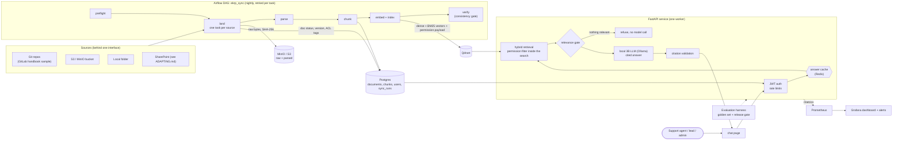

# Architecture

## The system in one picture

## What each layer guarantees

| Layer | Code | Guarantee |
|---|---|---|
| Connectors | `connectors/` | Everything downstream sees only `SourceDocument` + bytes. Adding a source = one class. |
| Landing | `ingestion/landing.py` | Idempotent: identical content (SHA-256) is never re-processed; originals are kept untouched. |
| Parsing / chunking | `ingestion/parsing.py`, `chunking.py` | Heading-aware chunks (max 320 tokens, 50 overlap); a document that cannot be parsed fails alone and is retried. |
| Indexing | `ingestion/indexer.py` | Point ids derive from chunk ids, so re-indexing overwrites instead of duplicating; stale points are deleted only after the new ones are in. |
| Sync | `ingestion/sync.py` | A failed or partial listing never deletes; an empty listing or >30% removal is refused unless forced. |
| Orchestration | `orchestration/` | Each stage is its own retryable task; `verify` fails the run if Qdrant and Postgres disagree. |
| Retrieval | `serving/retrieval.py` | The role's permission filter is part of every vector query (never applied afterwards). Unknown role = error; empty allow-list = nothing. |
| Generation | `serving/generation.py` | Off-topic questions are refused before any model call; an answer without a valid citation is not shown as fact; invalid `[n]` markers are stripped. |
| API | `serving/api_core.py` | Roles are read fresh on every request (revocation is immediate); the cache key includes the role's permissions, the corpus version and the model/prompt, so one role can never be served another's cached answer. |
| Observability | `serving/metrics.py`, `infra/` | Answer outcomes, latency breakdown, CPU gate, pipeline freshness; alerts on availability, quality drift and a stale index. |
| Evaluation | `eval/` | Deterministic checks on a golden set; a gate that fails on leaks, thresholds or regression against a frozen baseline. |

## Key design decisions (and what they cost)

- **Permissions inside the search, not after it.** Post-filtering can leak through a bug and wastes
  top-k on chunks the user cannot see. Cost: the filter must be present on every Qdrant prefetch
  (tested), and the metadata must be on every chunk.
- **Hybrid retrieval (dense + BM25, fused with RRF).** Support questions contain error codes and
  exact strings that dense vectors blur. On the 15-question starter set dense and hybrid were
  statistically indistinguishable; hybrid stays for robustness on keyword-heavy queries.
  Cross-encoder reranking was measured and **disabled**: no gain, ~15 s on CPU.
- **A relevance gate before the model.** The best dense cosine similarity must clear a calibrated
  threshold (0.64; real questions scored >= 0.713, off-topic <= 0.612). Off-topic questions are
  refused in ~30 ms instead of 15 s, and cannot be talked into an answer.
- **A small local model on purpose.** `llama3.2:3b` runs on a laptop CPU (p50 ~14 s per answer).
  The price is quality variance, which is why citations are validated mechanically and why
  evaluation does not use the model as a judge.
- **One API worker.** The embedding model and LLM client live in the process and the generation
  gate that protects the CPU is per-process. Scaling out means moving the gate to Redis (not done).
- **Postgres is the source of truth for the index.** Qdrant can be rebuilt from Postgres + object
  storage (`scripts/run_indexing.py --recreate`), so only Postgres and MinIO need backups.

## Measured results

Corpus: GitLab handbook sample, 400 documents (393 indexed, 7 empty section pages skipped),
3,823 chunks. All numbers from a CPU-only Windows laptop.

| What | Result | Source |
|---|---|---|
| Right page retrieved (answerable questions) | 97% | `scripts/run_eval.py`, 31 cases / 49 runs |
| Answered when it should | 90% | same |
| Cited the expected page | 73% (several misses are plausible alternative pages) | same |
| Required facts present in answers | 96% (weak, title-derived facts) | same |
| Sentences unsupported by their cited sources | 3% (word-overlap proxy) | same |
| Off-topic questions refused | 100% (10/10) | same |
| Permission leaks / system-prompt leaks | 0 / 0 | same |
| Answer latency p50 / p95 | 14.5 s / 24.1 s (CPU, 3B model) | same |
| Off-topic refusal latency | ~30 ms | same |
| Incremental sync of a changed corpus | ~77 s end to end through Airflow | `airflow dags test` |
| Retrieval modes (15 questions) | dense ~ hybrid >> BM25 alone; reranker no gain | README, "Retrieval" |

**Limits of these numbers:** 31 questions is a small set; the "permissions" are *synthetic*
(derived from the path, see below); `grounded` is a lexical proxy, not semantic faithfulness; one
run, one machine. They are enough to catch regressions and to compare configurations, not to
promise accuracy on a different corpus.

## The permissions are simulated

The open-source corpus has no access control. `ingestion/metadata.py` assigns each document a
department, access level and product **deterministically from its path** (with a hash-based
fallback), and `config/company.yaml` maps three roles onto those tags. This exercises the real
mechanism (tag every chunk, filter inside the vector search, key the cache on permissions, test for
leaks) but it is not SharePoint's permission model. `docs/ADAPTING.md` describes the mapping for a
real source.
